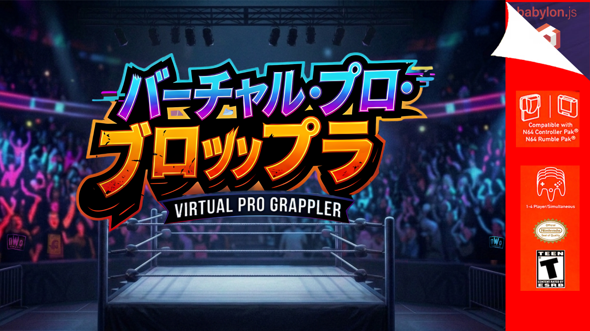

# Virtual Pro Grappler



[](https://www.gnu.org/licenses/gpl-3.0)


Virtual Pro Grappler is an open-source professional wrestling game and engine inspired by the AKI-era N64 wrestling games: WWF No Mercy, Virtual Pro Wrestling 2, WCW/nWo Revenge, and related titles.

The project is currently in an early engine and tooling phase. The focus right now is building the data model, UI flow, arena rendering pipeline, and control mapping foundation before full match gameplay comes online.

## Current State

What runs today:

- A data-driven main menu built from `data/ui/main-menu.json`.
- A single main menu with Multi Play, Single Play, and Commissioner submenus.
- A Commissioner Controls screen with remappable keyboard bindings.
- UI button texture support for D-pad, control stick, C-buttons, A, B, Z, Start, L, and R.
- An Arena Viewer selection screen with arena preview images.
- A combat system tester with player and opponent, in a ring, with stats heads-up display
- Babylon.js arena loading only after an arena is selected/opened.
- Arena Viewer camera controls for rotate and zoom.
- JSON schemas for main menu data, moves, and move slots.
- Move and move-slot data files under `data/combat`.
- Arena definitions under `data/environments/arenas`.
- Vite build/dev tooling and Vitest test setup.

## Getting started

```bash
npm install
npm run dev        # http://localhost:8080
```

| Script | Does |
|---|---|
| `npm run dev` | Vite dev server |
| `npm run build` | Typecheck, then production build |
| `npm run typecheck` | `vue-tsc` over src and tests |
| `npm test` | Vitest suite (`tests/**/*.test.ts`), including data validation |
| `npm run test:watch` | Vitest in watch mode |
| `npm run validate:data` | Schemas, asset references and menu targets in `data/` |
| `npm run assets:promote` | Copy the shipped asset subset out of `assets/source` |

## Project structure

The project is organized by responsibility. Domain-specific resources use the
same categories across the `data/`, `assets/` and `docs/` trees where possible;
see [the resource layout guide](docs/resource-layout.md) for the full
conventions.

```text
.
├── src/                  Application and game-engine source code
│   ├── audio/            Menu music and sound playback
│   ├── data/             Data loading, catalogs, stores, and asset paths
│   ├── game/             Runtime game systems and virtual controller logic
│   │   ├── combat/       Damage, reversals, wrestler state, match
│   │   └── sim/          Fixed timestep, input buffer, seeded RNG
│   ├── renderer/         Babylon.js scenes, arena loading, and rendering helpers
│   └── ui/               Vue components for menus, controls, and arena tools
├── data/                 JSON definitions and schemas used by the application
│   ├── animations/       Animation metadata (empty; not started)
│   ├── characters/       Character definitions
│   ├── combat/           Moves and move slots
│   ├── environments/     Stages, arenas, and ring geometry manifests
│   ├── schemas/          JSON Schema files for validating data
│   ├── settings/         Default control mappings
│   └── ui/               Menu and interface definitions
├── assets/               Models, textures, audio, and other runtime resources
│   ├── animations/       Animation clips baked into the character models
│   ├── characters/       Character models and textures
│   ├── combat/           Combat-related resources (empty)
│   ├── environments/     Arena, ring, stage, and prop resources
│   ├── settings/         Settings-related resources (empty)
│   ├── ui/               Fonts, audio, controller textures, artwork, favicon
│   └── source/           Blender and raw GLB originals; git-ignored, never shipped
├── docs/                 Design notes and implementation documentation
│   ├── animations/       AKI rig migration and move-animation plans
│   ├── characters/       Create-a-Wrestler plan
│   ├── combat/           HFSM, moves, damage, parameters, and reversal specifications
│   └── resource-layout.md
├── tests/                Vitest tests for data, controls, menus, arenas, and assets
│   ├── combat/           Damage, reversal, and simulation tests
│   ├── browser/          Playwright scripts driving the menus, arenas, and camera
│   └── browser-combat/   Playwright script driving the development combat test
├── tools/                Vite dev-server extensions, asset pipeline, and data validation
├── index.html            Vite application entry HTML
├── package.json          npm scripts and dependencies
├── vite.config.ts        Vite configuration
├── vitest.config.ts      Vitest configuration
├── eslint.config.js      ESLint configuration
└── tsconfig.json         TypeScript configuration
```

`data/` contains structured definitions that can be validated and edited as
JSON. `assets/` contains the files those definitions reference, such as
textures, audio and models. The app is built from `src/`, while `docs/` records
the conventions and design work behind the data and systems.

The Playwright scripts in `tests/browser*` are run by hand against a running
dev server (`node tests/browser/test-menu.mjs`; set `GAME_URL` to use another
port). The combat scripts rely on a development-only hook, so they need
`npm run dev` rather than a production build.

### Assets

`assets/source` is the authoring tree — Blender and raw GLB
originals. **Nothing there reaches the browser.** The shipped
subset is copied out by:

```bash
npm run assets:promote        # copy anything missing or stale
npm run assets:promote -- --check   # report drift without changing anything
```

The manifest in [`tools/promote-assets.mjs`](tools/promote-assets.mjs) is the
record of what ships and where it lands, so a working asset tree is
reproducible from source rather than something assembled by hand.

Vite has no public directory. Models, textures and fonts under
`assets/characters`, `assets/environments` and `assets/ui` are bundled by the
glob in [`src/data/assets.ts`](src/data/assets.ts) and referenced from JSON and
config by repository path; audio, controller icons and the favicon are
imported directly. [`resolveAsset()`](src/data/assets.ts) takes a path as
authored and returns its built URL. That is the single entry point — new code
should not build asset URLs by hand.

## Menu

The app opens on a data-driven menu defined by
[`data/ui/main-menu.json`](data/ui/main-menu.json):

```text
Main Menu
├── Multi Play          (not implemented)
├── Single Play         (not implemented)
└── Commissioner
    ├── Smackdown Mall
    │   └── Combat System Test   → the playable prototype
    ├── Options         (not implemented)
    ├── Arena Viewer    → the arena viewer
    └── Controls        → the control mapper
```

The **Arena Viewer** lists the ten arenas in [`data/environments/arenas/`](data/environments/arenas/)
with their preview art, and renders the selected one: the ring, two sets of
steps, and the environment GLBs the arena file names, with its configured
textures and colours applied. The control stick orbits the camera, `C-Up`/`C-Down`
zoom, `Esc` closes. It renders the ring's static rope meshes rather than the
elastic `RingRopes` system, which is gameplay rather than presentation.

Menus are driven by a virtual N64 pad rather than raw keys: arrows or `W`/`S`
move the cursor, `Enter` selects, `Esc` goes back, and `Z` shows the
instructions panel for the highlighted item. Rebinding any of those in
Controls changes the menus with it.

The control mapper lists all 18 pad inputs, warns before taking a key that is
already in use, persists to `localStorage` under `vpg-control-mappings`, and
can reset to defaults or export the active mapping as JSON.

## Controls

The Combat System Test is played on the same virtual N64 pad as the menus, so
whatever Controls binds to a button is what drives it:

| Pad input | Action |
|---|---|
| Control Stick / D-Pad | Move |
| `C-Down` | Run. Hold it into the ropes to rebound, or into a corner to climb |
| `B` | Punch. With a direction held, kick |
| `R` | Block. While running, roll |
| `Start` | Pause |

The mouse moves the camera: drag to orbit the ring, scroll to zoom. Directions
are fixed to the ring rather than the camera: up is always north, down south,
and so on, however the camera is turned.

The move slots in [`data/combat/move-slots.json`](data/combat/move-slots.json)
are written against that same pad.

## Asset pipeline

Character GLBs live in `assets/source/characters` and are copied to
`assets/characters/models` by `npm run assets:promote`.

Every character is on the 19-joint AKI rig (`Pelvis`, `LowerAbdomen`,
`UpperBody`, `Neck`, `Head`, and the arm and leg chains), the rig the N64 AKI
games used, so a clip made for one wrestler plays on all of them.
[`prepare-character-glb.mjs`](tools/prepare-character-glb.mjs) fits each export
to the game on its way out of the source tree:

- clears the `alphaMode: MASK` and `doubleSided` flags on every material;
- packs the per-part textures into one atlas. The AKI export places its UVs
  outside [0, 1] and relies on mirrored-repeat samplers, so each atlas cell
  holds its texture already tiled over the range its UVs cover;
- marks the material unlit, since the shading is painted into the textures;
- scales and turns the root node: the export stands 3.635m tall and faces −Z,
  the game wants 1.812m facing +Z;
- renames clips to snake_case `animation_id`s (`Austin Punch` → `austin_punch`,
  the unnamed idle → `idle`), keeping the original name in the clip's
  `extras.source_clip`;
- takes each clip's horizontal `Pelvis` travel out onto a separate
  `root_motion` track, so the body plays in place over its root.

The settings for each character sit in its entry in
[`promote-assets.mjs`](tools/promote-assets.mjs). It runs as part of
`npm run assets:promote` rather than by hand, because a re-export undoes all of
it. `tests/characterAssets.test.ts` fails if a raw export reaches
`assets/characters/models` unprepared, if the skeleton is not the AKI rig, or if the
character ends up facing the wrong way.
