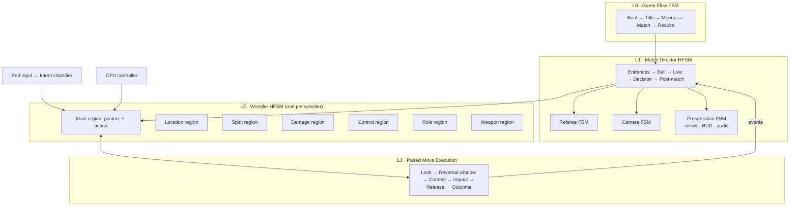
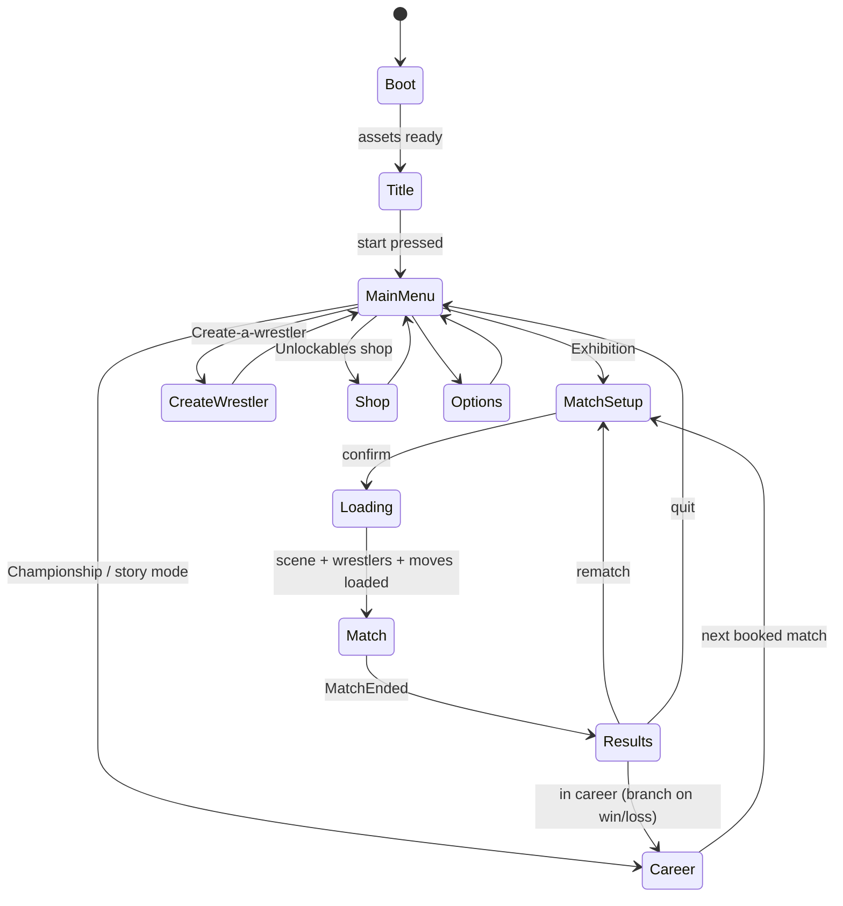
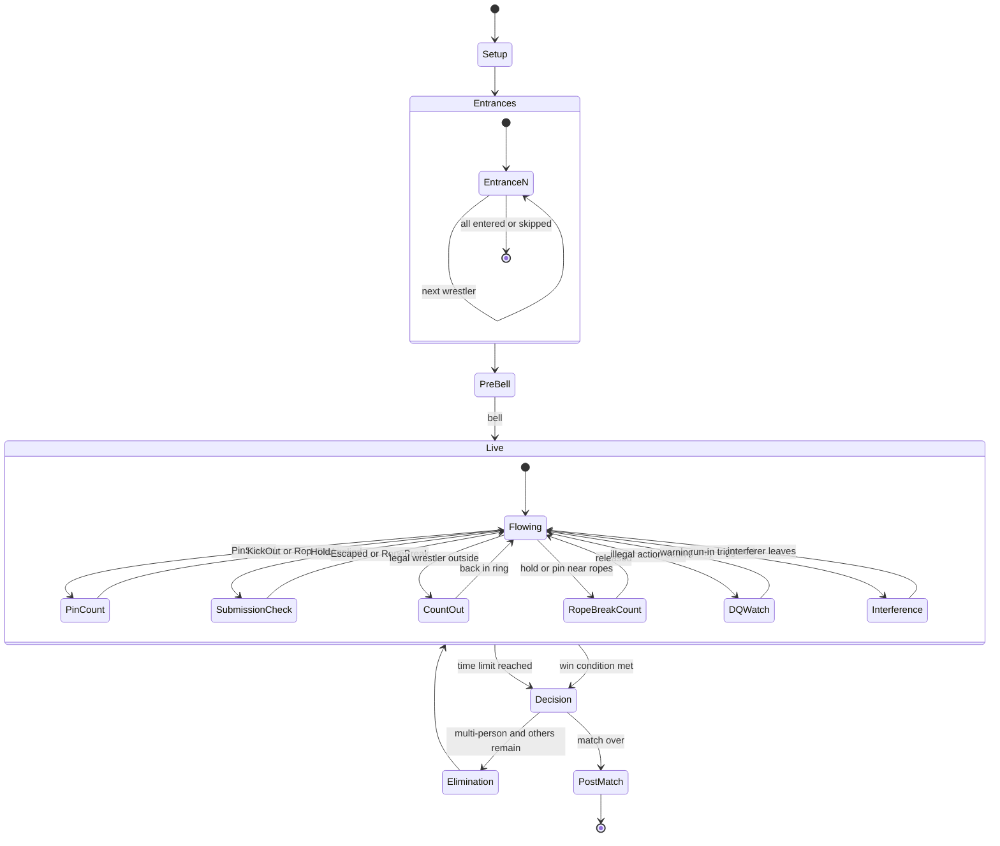
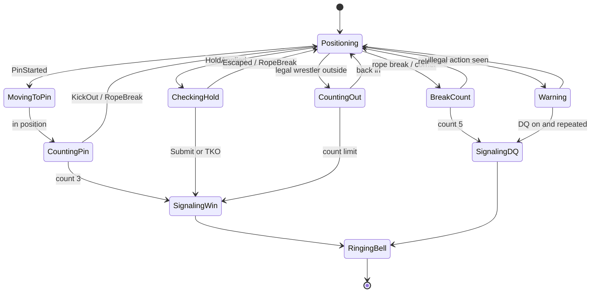
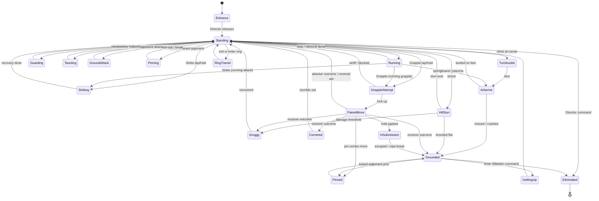
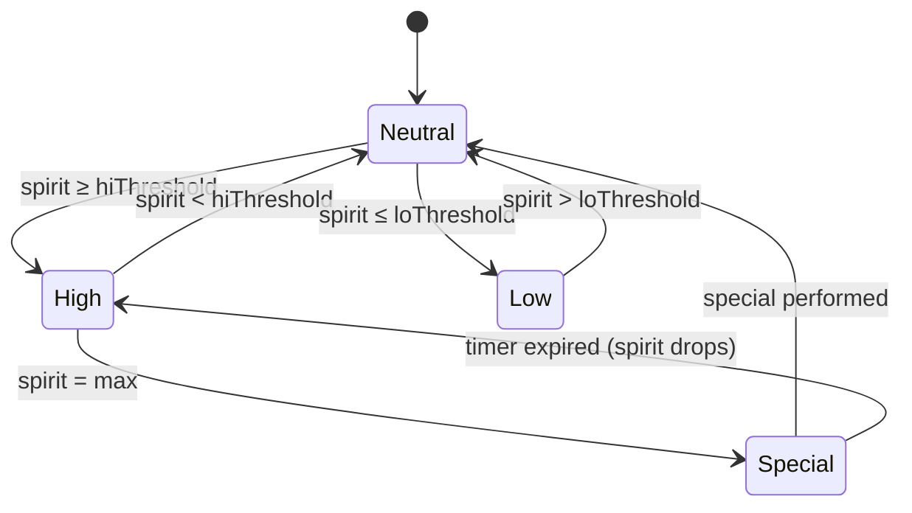
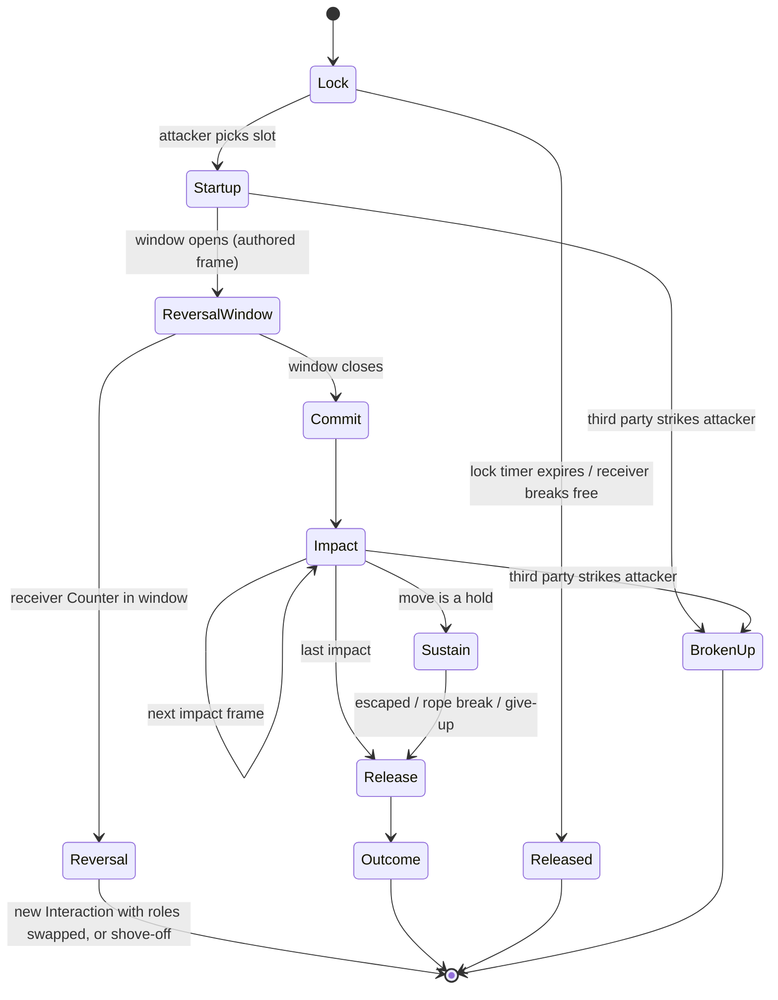
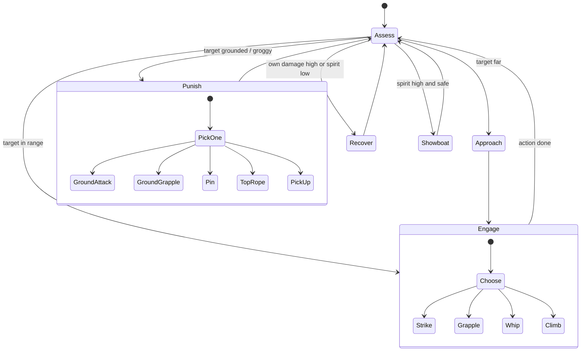

# No Mercy–Style Wrestling Game — HFSM Plan (Babylon.js)

**Status:** Planning draft v0.1 · **Target engine:** Babylon.js (TypeScript, Vite) · **Reference cartridge:** WWF No Mercy (USA) Rev A, NTSC-U v1.1, inspected in AKI Anvil

> **Clean-room note.** Everything below describes *observable gameplay* and the *shape* of the data the cartridge stores, as surfaced by AKI Anvil's editors and data tables. No game code was read or reproduced. Field shapes are borrowed so the new game feels the same; all numbers that ship should be re-authored and tuned in-house.

---

## Table of contents

1. [Goals and feel targets](#1-goals-and-feel-targets)
2. [What the ROM tells us](#2-what-the-rom-tells-us)
3. [Architecture overview](#3-architecture-overview)
4. [L0 — Game flow FSM](#4-l0--game-flow-fsm)
5. [L1 — Match Director HFSM](#5-l1--match-director-hfsm)
6. [L2 — Wrestler HFSM](#6-l2--wrestler-hfsm)
7. [L3 — Paired move execution](#7-l3--paired-move-execution)
8. [Combat resolution rules](#8-combat-resolution-rules)
9. [CPU controller](#9-cpu-controller)
10. [Babylon.js implementation](#10-babylonjs-implementation)
11. [Data schemas](#11-data-schemas)
12. [Build order](#12-build-order)
13. [Open questions to verify in AKI Anvil](#13-open-questions-to-verify-in-aki-anvil)

---

## 1. Goals and feel targets

The point of the HFSM is to reproduce what makes No Mercy play the way it does. Every state and transition below should serve one of these:

| # | Feel target | What it means for the state machine |
|---|---|---|
| F1 | **Grapple-first combat** | Most offense starts from a tie-up. The *context* the attacker is in (front, back, corner, ground, running, apron…) decides which move slot a button press resolves to. Contexts are states. |
| F2 | **Tap vs. hold** | Tap = weak, hold = strong, for both grapples and strikes. Input layer must classify press duration before the state machine sees an intent. |
| F3 | **Timing-based reversals** | Nearly every move has a window where the defender can counter. Reversal windows live inside the move execution sub-machine, not in ad-hoc checks. |
| F4 | **Spirit (momentum)** | A single meter per wrestler swings with every move landed, taken, taunted. At the top it unlocks a timed *SPECIAL* state. Spirit is an orthogonal region that modifies guards everywhere else. |
| F5 | **Body-part damage** | Damage accumulates on head, body, arms and legs separately. It drives get-up speed, pin kick-outs and submission outcomes. Another orthogonal region. |
| F6 | **Positional storytelling** | Moves leave the receiver in a specific posture (face up, face down, sitting, groggy, in the corner, on the apron, outside). The outcome posture is data on the move, and it dictates the next set of legal contexts. |
| F7 | **Rule-driven matches** | Match types are bundles of switches (count-out, DQ, rope breaks, interference, time…). The Match Director reads a rule set; it never hard-codes a match type. |
| F8 | **Same code for humans and CPU** | CPU opponents emit the same intents a pad does, so every state behaves identically for both. |

---

## 2. What the ROM tells us

Findings from browsing the loaded cartridge in AKI Anvil (Wrestlers, Moves, Animations, Data tables). These are the **design inputs** the HFSM is built around.

### 2.1 Inventory

| Asset | Count in cartridge | HFSM relevance |
|---|---|---|
| Wrestlers | 74 | Attribute records feed damage, speed and size-class alignment |
| Moves | 2,136 records (1,761 named) | Each record = one executable action with damage/spirit/pin payload |
| Animations | 5,789 (3,886 named) | The posture and transition vocabulary — every state needs a clip |
| Rule sets | 58 rows × 13 fields | The Match Director's configuration |
| Music | 77 (50 entrance themes, 27 songs) | Entrance and presentation states |

### 2.2 Move record shape

Every move in the Moves table carries the same small payload:

| Field | Observed range | Most common values | Interpretation for our design |
|---|---|---|---|
| Damage | 0 – 45 | 0 (761 records), 2, 5, 15, 10, 3, 25 | Base damage. Zero-damage records are transitions, taunts, setups and many reversal stubs. |
| Own spirit | 0 – 15 | 0, 7, 5, 3 | Spirit gained by the **attacker** when the move lands. |
| Their spirit | −15 – +8 | 0, −10, −3, −7, −5 | Spirit change for the **receiver** (almost always a loss). |
| Pin | 1, 2, 3, 5, 7 | 1 (1,731), 3 (307), 5 (95) | *Inferred:* pin weight after the move. Takedowns (Arm Drag, Snapmare, Scoop Slam, Fireman Carry) sit at 3; big impact moves (DDTs, Chokeslams, Michinoku Driver) at 5. Treat as a kick-out difficulty modifier. |
| Chain | 0 – 45 | Matches Damage in all but 38 records | *Inferred:* total damage when a move chains into a follow-up. The 38 differences are reversals (0 → 20–33) and multi-stage moves like "Hip Toss to Submission" (25 → 45). Model as a separate `chainDamage` used when a multi-phase move completes. |
| Key | e.g. `N0339-A` | — | Animation key. Our equivalent: the GLB / AnimationGroup id for the paired clip. |

**Design consequence:** a move is *data*, not code. The state machine owns timing and context; the move record owns the payload. This keeps the 2,000-plus move library from leaking into state logic.

### 2.3 Wrestler record shape

From the Profile editor (The Rock used as the sample):

| Group | Fields | HFSM use |
|---|---|---|
| Body | Height (5'0"–7'11", plus **Short / Medium / Tall size class**), Weight 100–599 lb, bone thickness | Size class picks alignment offsets for paired animations; weight can gate lifts if desired |
| Speed | 0–n | Walk/run speed, get-up speed |
| Attack ratings | Head, Body, Arms, Legs, **Flying** | Multiplies damage by move type/target |
| Defence ratings | Head, Body, Arms, Legs, **Flying** | Divides incoming damage per body part |
| Specific weapon | id | Signature weapon for ringside/hardcore states |
| Relationships | Rival 1–3 (+ kind), Partner (+ kind) | Interference and run-in logic |
| Presentation | Theme song, entrance video, costumes (4) | Entrance states |
| Unlabeled | Fields 1–8, 20–36, flags | Probably behaviour/AI tuning — reserve hooks (see §13) |

### 2.4 Move-slot taxonomy = the context map

The per-wrestler Move list groups slots exactly the way a game manual would. **Each group is a context state in the Wrestler HFSM**, and each slot is what an input resolves to inside that context. The Rock's set has 135 slots:

| Group (slot count) | Slots inside the group | Owning HFSM state |
|---|---|---|
| **Strikes** (15) | Standing weak arm ×2, standing weak leg ×2, strong ×8, recovering attack, kick/stomp, sliding stomp | `Striking`, `Grounded.GettingUp`, `GroundAttack` |
| **Front grapples, weak** (9) | Front grapple weak (A) ×4, weak grapple (B) ×5 | `Grappling.Front.Weak` |
| **Front grapples, strong** (8) | Front grapple strong ×8 | `Grappling.Front.Strong` |
| **Back grapples** (8) | Back weak ×4, back strong ×4 | `Grappling.Back.*` |
| **Running** (17) | Irish whip front grapple weak ×4, running front grapple, running back grapple, running attack vs standing ×4, vs corner ×3, running ground attack ×4 | `Running`, `Grappling.Whip`, `Grappling.RunningFront/RunningBack` |
| **Corner** (8) | Front turnbuckle weak ×2 / strong ×2, back turnbuckle weak+strong ×4 | `Grappling.Corner.*` |
| **Top rope** (7) | Flying attack vs standing ×2, vs laying ×2, running diving ×2, flying attack from apron | `Turnbuckle.Perched` → `Airborne` |
| **Ground** (12) | Standing ground attack ×2, sitting ground attack ×2, upper/lower body × face up/face down ground grapples, sitting up/down variants | `GroundAttack`, `Grappling.Ground.*` |
| **Ringside** (6) | Ringside grapple to apron ×2, apron strong grapple from apron ×2, apron attack to inside / to outside | `Grappling.Ringside.ToApron`, `Grappling.Apron.FromApron`, `RingTransit` |
| **Double team** (7) | Irish whip, front, back, sandwich, double-team reversal, opponent on shoulders ×2 (+ "to ring for the Doomsday Device") | `DoubleTeam.*` (tag/multi-man only) |
| **Specials** (10) | Front, back, irish whip, front/back turnbuckle, ground face up head/feet | Any grapple context **while Spirit = SPECIAL** |
| **Reversals** (16) | Back grapple counter, turnbuckle front/back counter, apron/ringside counters, counter punch/kick (+ special counters), enzuigiri reversal, irish whip to corner counter, evasion, armbar and rear naked choke reversals | `PairedMove.ReversalWindow` outcomes |
| **Taunts** (12) | Entry-way, walking, in-ring entrance, standing ×10, ducking, corner, turnbuckle, apron, diving taunt | `Taunting`, `Entrance.*` |

Additional slots surfaced in the full list: **combo strikes** (spinning back hand from front grapple, overhand slap from back grapple), **rope inside attack**, **turnbuckle inside attack**, **rebound flying attack**, **flying attack to outside**, **flying attack to ring from apron** (vs standing / laying), **running flying attack from apron**.

### 2.5 Rule-set table (`default_rulesets`)

58 rows, 13 fields: `ruleset type`, `time limit`, `count out`, `pinfall`, `submission`, `tko`, `rope break`, `dq`, `blood`, `interference`, `tag help time`, `time count`.

Observations that shape the Match Director:

- Rows 0–14 are one default per **ruleset type 0–14**; the remaining rows are variants that reuse types 0, 1, 2 and 13 with different switches.
- Types 4 and 5 zero out almost everything (no count-out, no TKO, no DQ) → *no-rules* style matches.
- Types 13 and 14 have `time limit = 0` and `time count = 1` → *time-scored* style matches.
- `tag help time` appears only on tag-type rows (values 1 or 5) → how long a partner can stay in to help.
- `interference` is set on many type-0 variants → run-ins are a rule toggle, not a match type.

**Design consequence:** the Match Director's guards read a `RuleSet` object with these same 12 switches. Match types are presets.

### 2.6 Animation vocabulary

About 470 of the named clips are *not* moves — they are the generic postures and transitions every wrestler shares. They are the best evidence for which states the original runs, so the HFSM below uses them as its state inventory. Grouped:

| Family | Representative clip names in the cartridge | Implied states |
|---|---|---|
| Locomotion | Standing · Walk forward / backward / sideways (one side, other side) · Run start / Run / Run stop · each in a *movement style* variant | `Standing.Idle`, `Standing.Walking`, `Running` with per-wrestler style sets |
| **Hurt locomotion** | Standing / Walk forward / Walk backward / Walk sideways / Guard — each with *hurt in the head, body, arms, legs* | Damage region swaps the locomotion clip set per most-damaged part |
| Guard and blocks | Guard · Guard taking a blocked strike (+ hurt variants) · Blocking a grapple attempt · Countering a grapple attempt · Catching a kick · Kick caught by the opponent | `Guarding`, block/catch outcomes |
| Tie-up | Grapple attempt (weak / strong) · Lock-up, the attacker · Lock-up, the one grappled · Leaping onto the opponent from the lock-up · Running into each other | `GrappleAttempt`, `PairedMove.Lock` |
| Hit reactions | Hit by a strike (strike / other / special reaction; *special reaction, health below N*) · Staggering backward · Doubled over after a move (+ straightening up) · Dazed on the feet · Going down on one knee · Knocked flat | `HitStun`, `Groggy.Doubled`, `Groggy.Dazed`, `Groggy.Kneeling`, damage-threshold reactions |
| Ground | Lying on the mat (poses) · Hit while lying on the mat (by ground attack, by splash, other side) · Rolling on the mat · Rolling sideways (one way / other way) · Rolled over by the opponent · Rolling the opponent over | `Grounded.FaceUp/FaceDown`, `Grounded.Rolling`, flip-opponent action |
| Get-ups | Getting up (kinds, **multi-step**) · Being picked up off the mat (approaches, steps, short form) · Picking up a downed opponent (+ short form) · Stepping over a wrestler on the mat · Running up to a wrestler on the mat | `Grounded.GettingUp` (stepped), `PickUp` paired action |
| Ropes | Bouncing off the ropes (into / out of, with weapon) · Grappled across the ropes · Falling over the top rope · Rolling under the ropes | `Running.Rebound`, rope-grapple context, `OverTheTop` elimination |
| Apron and exits | Leaving the ring (two steps, other form, with weapon) · On the apron (two steps) · Grappled from the apron · Grappling from the apron | `Location.OnApron`, `RingTransit` |
| Corner | Leaning in the corner · Stuck in the corner (other side, stumbling out) · Hanging / hung upside down in the corner (dropping down) | `Cornered.Leaning`, `Cornered.Stuck`, `Cornered.Hanging` |
| Turnbuckle | Springing onto the turnbuckle (crouching on top, from outside, getting down) · Diving off the turnbuckle with a weapon | `Turnbuckle.Climbing/Perched/Descending` → `Airborne` |
| Weapons | Reaching for / Picking up a weapon (bending down, standing up with it) · Standing / Walk / Run holding a weapon · Swinging a weapon (weak, strong, on the run, at a downed opponent; **grips 0–3**) · Throwing / Dropping a weapon · Standing a weapon up | `Weapon` region with a grip index |
| Ladder | Setting up a ladder · Picking up a standing ladder · Getting onto / Climbing up / Climbing down the ladder · On the ladder · At the top · Reaching up from the top · Striking / Blocking a strike from the top · Kicking from the ladder · Jumping off the top · Knocked off / Falling off · Pulling the opponent off (from inside / outside the ring) | `Ladder.*` sub-machine |
| Cage | Climbing the cage · Climbing over the top · Climbing down the outside · Pulled off the top · Pulling a climber off · Against the cage wall (attacker / the one driven) · Running into the cage wall | `Cage.*` sub-machine |
| Tag | Reaching for a tag · Making a tag | `Role.PartnerOnApron`, paired tag action |
| Referee | Counting a pin (getting down, waiting, a count, count of three, raising the hand, broken off, after a kick-out, after a kick-out just before three, waving it off at the ropes) · Asking for a give-up (kneeling, standing, waving it off at the ropes) | Referee FSM states in §5.3 |
| Misc | Back to a stance after an action · Turning to face another wrestler · Run start / stop *during a move* · Running into the ring steps | Recovery tail after every action; focus switching; environment collisions |

Two details worth copying exactly:

- **"Health below N" strike reactions** and **hurt-part locomotion** mean the visible animation set changes as damage accumulates. That is a cheap, high-impact part of the feel.
- **Get-ups and pick-ups are multi-step.** They are short sequences with interruptible steps, not a single clip, which is why ground attacks can land mid-get-up.

### 2.7 Matchup categories

AKI Anvil's per-wrestler rating breaks performance into **Ground, Aerial, Running, Counters, Strikes, Grapples** (taunts, tag-team and ringside moves excluded). Those six buckets are a ready-made set of weights for the CPU controller (§9).

---

## 3. Architecture overview

Four nested levels plus side machines. Each level only talks to the level directly above or below it through **intents** (down) and **events** (up).



### 3.1 Principles

1. **Fixed simulation tick.** All state logic runs at a fixed 60 Hz step, independent of render frame rate. Animation frame windows (reversal, impact) are authored in clip frames and converted to ticks once at load time.
2. **Intents, not buttons.** States never read the gamepad. The input layer produces `Intent` objects (`GrappleWeak`, `GrappleStrong`, `StrikeWeak`, `StrikeStrong`, `Counter`, `Run`, `Taunt`, `Interact`, `Pin`, `Tag`, `Move(dir)`, `Mash`). The CPU emits the same intents.
3. **Orthogonal regions for meters.** Spirit, damage, location, control, role and weapon are parallel regions inside each wrestler. The main region reads them through guards; they never own transitions of the main region.
4. **One authority per interaction.** When two wrestlers lock up, an `Interaction` object is created and becomes the single authority for both. Both wrestlers enter `PairedMove` and are driven by it until it releases them. This is what keeps paired animations in sync and makes reversals deterministic.
5. **Context resolves slots.** The main region's *active leaf state* plus the intent plus stick direction picks a move slot. Slot → move id comes from the wrestler's move set. No state contains a move name.
6. **Events up, never sideways.** Wrestlers emit events (`MoveImpact`, `PinStarted`, `RopeTouched`, `LeftRing`, `SpiritMaxed`, …). The Match Director listens. Wrestlers never query each other's state except through the `Interaction` or a spatial query service.

### 3.2 State naming

States are addressed by path: `Wrestler.Main.Grappling.Front.Strong`. The debug overlay prints the active path of every region per wrestler; that path is also what replays and bug reports log.

---

## 4. L0 — Game flow FSM

A flat FSM is enough here. Modes are suggestions modeled on the original's menu structure.



| State | Entry | Exit |
|---|---|---|
| `Loading` | Build Babylon scene, load arena GLB, wrestler GLBs, the move GLBs in each wrestler's set, audio | Dispose previous match scene |
| `Match` | Instantiate Match Director with `MatchConfig { ruleSet, wrestlers[], teams[], arena }` | Collect `MatchResult` |
| `Career` | Load story graph; next node chosen by last `MatchResult` (win/loss branches) | Save progress |

---

## 5. L1 — Match Director HFSM

The Match Director owns the match clock, the rule set, win conditions and the referee. It never moves a wrestler directly; it sends **commands** (`ForceRelease`, `FreezeForEntrance`, `ReturnToCorner`, `Eliminate`) that wrestler states accept or queue.



### 5.1 RuleSet guards

| RuleSet field | Guard / behaviour |
|---|---|
| `timeLimit` | Index into a duration table; `0` = no limit. When the clock expires → `Decision(draw)` unless `timeCount` |
| `countOut` | `0` disables `CountOut`; otherwise index to count length |
| `pinfall` | Enables `PinCount` decisions |
| `submission` | Enables `SubmissionCheck` decisions |
| `tko` | Allows referee stoppage when a body part reaches critical damage and a hold is applied |
| `ropeBreak` | Enables `RopeBreakCount`; pins/holds with a rope-touching participant are broken |
| `dq` | Enables `DQWatch` (weapon use in ring, refusing a rope break, low blows if desired) |
| `blood` | First-blood style decision when any wrestler's `bleeding` flag sets |
| `interference` | Allows the Director to spawn rival/partner run-ins (uses wrestler Rival/Partner fields) |
| `tagHelpTime` | In tag matches: seconds a non-legal partner may stay in the ring to help before the referee forces them out |
| `timeCount` | Score-over-time mode: falls tally points instead of ending the match; winner decided at time expiry |

### 5.2 Match-type modules

Match types are presets of the switches above plus an optional **module** that adds states to `Live`:

| Module | Adds | Notes |
|---|---|---|
| Single | — | Baseline |
| Tag | `LegalTracker` sub-machine (`Legal`, `OnApron`, `Helping`, `Returning`), hot-tag event | Uses double-team slots |
| Triple/Fatal 4-Way | Multiple-target focus; break-up interruptions on pins | Pins may be broken by a third party |
| Battle Royal / Rumble | `OverTheTop` elimination watcher, `Entrant timer` for rumble | Elimination = both feet hit floor after going over the top rope |
| Ladder | `LadderProp` FSM, `BeltGrab` win condition | Wrestler adds `OnLadder` location |
| Cage | `CageWall` climbing, `Escape` win condition | Wrestler adds `OnCage` location |
| Time-scored | `FallTally` | Driven by `timeCount` |
| Submission-only / "I Quit" | Pinfall off, submission on | Pure presets |
| First Blood | `blood` on, pinfall off | Requires bleeding flag in damage region |

### 5.3 Referee FSM

The referee is a real actor in the ring, which matters for feel (counts start when he arrives).



- The cartridge's referee clips map one-to-one onto these states: *getting down to count → waiting to count → a count → the count of three / raising the hand*, with exits *broken off*, *after a kick-out*, *after a kick-out just before three* and *waving it off at the ropes*. Give-ups have kneeling and standing versions of *asking* and *waving it off*.
- Pin count speed is fixed per tick; kick-out checks happen at each count tick (§8.4). A "kick-out just before three" reaction plays when the kick-out lands in the last few ticks of the count — a small touch that sells near-falls.
- The referee walks to the pin. A pin started far from him gives the defender extra time, which keeps cheap early pins from ending matches.

### 5.4 Camera FSM

`EntranceCam → WideRing → FollowAction → PinZoom → OutsideTrack → ReplayCam → VictoryCam`. Driven by Director events; never by wrestler states directly.

---

## 6. L2 — Wrestler HFSM

One instance per wrestler. It has a **main region** (posture + action) and **seven orthogonal regions** that run in parallel.

### 6.1 Regions at a glance

| Region | States | Who changes it | Read by |
|---|---|---|---|
| **Main** | See §6.2 | Intents, Interaction, Director commands | Everything |
| **Location** | `Aisle`, `InRing`, `OnApron`, `Outside`, `OnTurnbuckle`, `OnLadder`, `OnCage` | Main-region exit/entry actions, spatial triggers | Director (count-out, eliminations), context resolver |
| **Spirit** | `Low`, `Neutral`, `High`, `Special` (timed) | Move payloads, taunts, time | Reversal windows, kick-outs, get-up speed, special slots |
| **Damage** | Per part (`head`, `body`, `arms`, `legs`): `Fresh → Worn → Hurt → Critical`; flag `bleeding` | Move impacts × attack/defence ratings | Locomotion clip set, hit reactions, kick-outs, submissions, TKO |
| **Control** | `Human(pad n)`, `CPU(level)`, `Scripted`, `Frozen` | Director, menus | Intent source |
| **Role** | `Legal`, `PartnerOnApron`, `Helping(timer)`, `Interfering`, `Eliminated` | Director (tag/multi-man modules) | Director guards, CPU |
| **Weapon** | `Unarmed`, `Reaching`, `Holding(grip 0–3)`, `Swinging`, `Throwing`, `Dropping` | Interact intent near a weapon, impacts | Strike resolution, DQ watch, locomotion set |
| **Focus** | `Target(id)` | Focus-switch intent, auto-retarget on elimination | Context resolver, facing |

The **locomotion clip set** is chosen by a priority rule across regions: `Weapon.Holding` → weapon set; else `Damage` most-hurt part ≥ `Hurt` → that part's hurt set; else the wrestler's *movement style* set. This one rule reproduces the "walking hurt" look from the cartridge.

### 6.2 Main region — top level



`PairedMove` is entered by **both** wrestlers at once and is driven by the `Interaction` (§7). Every state also accepts the Director commands `Freeze`, `ForceRelease`, `Eliminate` and `Teleport`.

### 6.3 Superstate reference

Each row lists entry actions, the intents a state consumes, and its exits. "Recovery tail" means the shared *back to a stance after an action* blend.

#### Standing (superstate)

| Substate | Entry | Accepts | Exits |
|---|---|---|---|
| `Idle` | Play stance from active locomotion set | everything below | — |
| `Walking` | Pick walk clip by direction relative to focus (forward, backward, sideways) | Move(dir) | `Idle` when stick neutral |
| `Turning` | "Turning to face another wrestler" when focus changes | — | `Idle` |

Standing is the hub. Its guards decide which context-sensitive action an intent becomes:

| Intent | Guard (checked in order) | Result |
|---|---|---|
| Grapple | Target `Grounded` in reach | `GroundGrapple` attempt (upper/lower by nearest end, face up/down from target posture) |
| Grapple | Target `Cornered` | Corner grapple attempt (front/back from target facing) |
| Grapple | Target `OnApron` and self `InRing` | Ringside grapple attempt |
| Grapple | Target `Turnbuckle.Perched` | Top-rope grapple attempt |
| Grapple | otherwise | Standing grapple attempt (front/back by relative facing) |
| Strike | Target `Grounded` | `GroundAttack` (stomp/kick) |
| Strike | otherwise | `Striking` weak (tap) / strong (hold) |
| Pin | Target `Grounded` and adjacent | `Pinning` |
| Interact | Weapon in reach and Weapon `Unarmed` | Weapon pick-up (Weapon region) |
| Interact | At corner, `InRing` | `Turnbuckle.Climbing` |
| Interact | At ropes | `RingTransit` (exit) |
| Interact | Target `Grounded` | Pick up opponent (paired, short form if spirit high) |
| Interact | Target `Grounded` face up/down | Roll opponent over (paired) |
| Tag | Partner `PartnerOnApron` reachable in own corner | Tag (Role swap) |
| Taunt | — | `Taunting` (standing/ducking/corner/turnbuckle/apron taunt from Location) |
| Counter | — | `Guarding` |
| Run | — | `Running` |

#### Running

| Substate | Notes |
|---|---|
| `Start` → `Loop` → `Stop` | Clips: run start / run / run stop (style, weapon variants) |
| `Rebound` | Hitting the ropes plays *bouncing off the ropes, into them → out of them* and reverses direction. While `Running` and whipped, the wrestler cannot steer. |
| `Whipped` | Entered from an Irish whip; locked direction toward ropes or corner. Rebounding back gives the whipper the *Irish whip front grapple* and *running attack* slots. Reaching a corner → `Cornered.Stuck`. |

Running intents: Strike → running attack slot (vs standing / vs corner / vs ground by target state); Grapple → running front/back grapple; Run again near ropes → springboard (`Airborne`) if the wrestler has a rope attack slot; Interact at ropes → dive to outside if target `Outside`. *Running into each other* is a paired collision when both run head-on.

#### GrappleAttempt

| Phase | Notes |
|---|---|
| `Reach` | Weak (tap) or strong (hold) attempt clip. Reach = distance ≤ grab radius and target within facing cone. |
| `Resolve` | Defender `Guarding` → *blocking a grapple attempt* → both to `Standing`. Defender presses Counter in the counter window → *countering a grapple attempt*: roles swap and the defender becomes the attacker. Simultaneous attempts → *lock-up* contest (§8.2). Otherwise → **create Interaction**, both enter `PairedMove.Lock`. |
| `Whiff` | Missed reach: recovery tail, punishable. |

#### Grappling contexts (attacker side of an Interaction before a move is chosen)

While the Interaction is in `Lock`, the attacker's main region sits in one of these context leaves. The leaf + intent + stick direction resolves the move slot (§6.4).

| Context leaf | Reached from | Slot group used |
|---|---|---|
| `Front.Weak` / `Front.Strong` | Standing grapple, facing | Front grapples weak / strong; combo strike; front special |
| `Back.Weak` / `Back.Strong` | Standing grapple from behind | Back grapples; combo strike; back special |
| `Whip` | Irish-whip input from a front grapple | Sends receiver to `Running.Whipped` |
| `RunningFront` / `RunningBack` | Grapple on a `Running.Whipped` target | Running front / back grapple; irish whip front grapple weak ×4; whip special |
| `Corner.Front` / `Corner.Back` | Grapple on `Cornered` target | Front/back turnbuckle weak/strong; turnbuckle specials |
| `TopRope` | Grapple on `Turnbuckle.Perched` target | Superplex-type slots (front/back turnbuckle grapple strong family) |
| `Ground.Upper.FaceUp` / `Ground.Upper.FaceDown` / `Ground.Lower.FaceUp` / `Ground.Lower.FaceDown` | Grapple on `Grounded` target | Ground grapples; special ground grapple face up head/feet |
| `Ground.Sitting.Upper` / `Ground.Sitting.Lower` | Grapple on `Grounded.Sitting` target | Sitting up/down ground grapples |
| `Ringside.ToApron` / `Apron.FromApron` | Inside ↔ apron grapples | Ringside grapple to apron; apron strong grapple from apron |
| `RopeGrapple` | Grapple a target leaning on the ropes | *Grappled across the ropes* |
| `DoubleTeam.*` | Two attackers lock one receiver (tag/multi-man) | Double-team front/back/sandwich/irish whip/on-shoulders |

#### Grappled (receiver side)

The receiver's leaf mirrors the attacker's context (`Grappled.Front.Weak`, `Grappled.Corner.Back`, …). It accepts only **Counter** (timing reversal, resolved by the Interaction) and **Mash** (struggle in holds). Its only exits are driven by the Interaction.

#### Striking

`Startup → Active → Recovery`. Active frames run a bone-attached hit volume. Outcomes on contact:

| Defender state | Result |
|---|---|
| `Guarding` | *Guard taking a blocked strike* (hurt-part variant), attacker recovery |
| Counter pressed in window | Counter punch / counter kick / *catching a kick* → paired reversal slot |
| otherwise | `HitStun` on defender, damage + spirit applied |

Weak strikes are fast with short recovery; strong strikes (hold) are slower, stagger or floor the defender, and have longer recovery. A wrestler `Grounded.GettingUp` with high spirit can fire the **recovering attack** slot (e.g. low blow from the knees).

#### Guarding

Held Counter. Blocks strikes from the front, blocks grapple attempts, and is the input that opens reversals (a *press* during a window, not the hold). Guard clip swaps by hurt part. Guarding too long can be made to drain spirit if needed for balance.

#### HitStun and Groggy

| Substate | Clip family | Exit |
|---|---|---|
| `HitStun.Light` | *Hit by a strike*, strike reaction | Timer → `Standing` |
| `HitStun.Heavy` | *Staggering backward* | Timer → `Standing` or `Groggy` |
| `Groggy.Doubled` | *Doubled over after a move* → *straightening up* | Timer (spirit, damage) or attacked |
| `Groggy.Dazed` | *Dazed on the feet* | Timer; a dazed target can be grappled without a contest |
| `Groggy.Kneeling` | *Going down on one knee* | Timer → `Standing` |
| `KnockedFlat` | *Knocked flat* | → `Grounded` |

Damage-threshold reactions (*special reaction, health below N*) are selected inside `HitStun` by the Damage region.

#### Cornered

| Substate | Clip family | Notes |
|---|---|---|
| `Leaning` | *Leaning in the corner* | Grapple → corner grapple contexts; running attack vs corner |
| `Stuck` | *Stuck in the corner* (+ other side) | After whip to corner; exits via *stumbling out* |
| `Hanging` | *Hung upside down in the corner* | Tree-of-woe style; exits via *dropping down* to `Grounded` |
| `Perched` | Seated on top turnbuckle (receiver) | Top-rope grapple target |

#### Grounded (superstate)

| Substate | Notes |
|---|---|
| `FaceUp` / `FaceDown` | Posture from the move outcome. Determines head/feet sides for ground grapples. |
| `Sitting` | Sitting up after some moves; uses sitting ground attack/grapple slots |
| `Rolling` | Defender stick input rolls sideways (both directions, both sides) or under the ropes to the apron/outside |
| `GettingUp` | **Multi-step**: `Step1 → Step2 → Step3`, each step interruptible. Speed = f(damage, spirit, speed attribute); Mash shortens it. Ground attacks landing mid-step reset to `FaceUp/FaceDown`. |
| `BeingPickedUp` | Paired with attacker *picking up a downed opponent*; ends in `Groggy.Dazed` or `Standing` |
| `BeingRolledOver` | Paired: *rolled over by the opponent* flips FaceUp ↔ FaceDown |

#### GroundAttack (attacker)

Stomp/kick (standing ground attack), running ground attack, sitting ground attack, splash from above. The receiver plays *hit while lying on the mat* (by ground attack / by splash / other side). Stepping over a downed wrestler plays *stepping over a wrestler on the mat* so the attacker can reach the other side.

#### Pinning / Pinned

| Attacker | Receiver | Director |
|---|---|---|
| `Pinning.Cover` (clip *Pinning*) | `Pinned` (clip *Pinned*), Mash accepted | Emits `PinStarted`; referee walks over and counts. Each count tick runs a kick-out check (§8.4). |
| `Pinning.Broken` | → `Grounded` | `RopeBreak` if receiver's limb is on a rope and the rule is on |

Pin-combo moves (e.g. *Hurracanrana Pin*) skip `Standing` and go straight from `PairedMove` into `Pinning/Pinned`.

#### InSubmission / ApplyingHold

Holds are paired moves with a **sustain phase**. During sustain:

- Receiver mashes to escape; attacker mashes to tighten.
- Escape progress vs. tighten progress, weighted by targeted part damage, spirit and attributes (§8.5).
- Near ropes with `ropeBreak` on → Director `RopeBreakCount`, referee *waving it off at the ropes*.
- Receiver at `Critical` on the targeted part → give-up (submission win) or referee stoppage (TKO, if `tko` on).

#### Turnbuckle

| Substate | Clip family | Notes |
|---|---|---|
| `Climbing` | *Springing onto the turnbuckle* (from inside or outside) | Interrupted by a strike → falls to `Grounded` or `Cornered.Perched` |
| `Perched` | *Crouching on top* | Aim at target; Strike/Grapple → `Airborne` dive; Interact → *getting down*; Taunt → turnbuckle taunt |
| `Descending` | *Getting down* | → `Standing` |

Dive slot is chosen by target state: standing → *flying attack, standing opponent*; grounded → *flying attack, laying opponent*; target `Outside` → *flying attack to outside*.

#### Airborne

Covers top-rope dives, springboards (*rope inside attack*, *turnbuckle inside attack*, *rebound flying attack*), apron dives (*flying attack from apron*, *to ring from apron*, *running flying attack from apron*), and dives to the outside. `Launch → Flight → Contact | Miss`. A hit produces a paired impact; a miss lands the attacker in `Grounded` with self-damage.

#### RingTransit

`ExitStep1 → ExitStep2` (*leaving the ring*, two steps), `OnApron` (two steps), `RollUnder` (*rolling under the ropes*), `EnterFromApron`. Location region updates on completion of each step, which is what the Director's count-out watches.

#### Ladder (module)

`SettingUp → Idle(prop) → Mounting → Climbing ↔ ClimbingDown → AtTop → Reaching → Grabbed (win)`, with `StrikingFromTop`, `BlockingFromTop`, `KickingFromLadder`, `JumpingOff` and failure exits `KnockedOff` / `FallingOff` / `PulledOff` (from inside or outside the ring). The ladder itself is a weapon prop with its own small FSM (`Lying → Carried → Standing → Toppling`).

#### Cage (module)

`Climbing → OverTheTop → ClimbingDownOutside → Escaped (win)` with interrupts `PulledOffTop` (paired with *pulling a climber off*). In-ring, the cage wall turns rope-based moves into *against the cage wall* paired impacts and running collisions into *running into the cage wall*.

#### Taunting

Clip from the wrestler's taunt slot that matches Location and posture (standing ×N, ducking, corner, turnbuckle, apron, diving). Commits for the clip's duration; spirit is applied at the payoff frame. Interrupted by any hit (no spirit gain).

#### Entrance

`Aisle.Walk` (walking moves) → `Aisle.Taunt` (entry-way taunt) → `RingEntry` → `InRing.Taunt` (in-ring entrance taunt) → waits for Director release. Driven entirely by `Control = Scripted`.

### 6.4 Context → slot resolution

Directions are relative to the attacker's facing toward the receiver: **N** = neutral, **U** = toward, **S** = sideways (either), **D** = away. Slot counts are what the cartridge allocates in The Rock's move list; the button/direction split is the proposed mapping for our game.

| Context | Weak slots | Strong slots | Special slots | Other |
|---|---|---|---|---|
| Front | 9 — A × N/U/S/D (4) + B × N/U/S/D (4) + 1 extra B slot to verify | 8 — A × 4 + B × 4 | 1–2 | Combo strike ×1, Irish whip |
| Back | 4 | 4 | 2 | Combo strike ×1, back counter ×2 (receiver side) |
| Running front (whip return) | 4 | — | 1 | — |
| Running grapple front / back | 1 / 1 | — | — | — |
| Corner front | 2 | 2 | 2 | Turnbuckle front counter (receiver side) |
| Corner back | 4 (weak + strong share) | — | 2 | Turnbuckle back counter (receiver side) |
| Ground upper/lower × face up/down | 1 each (4) | — | head / feet | Pin, pick-up, roll-over |
| Ground sitting upper/lower | 1 each (2) | — | — | — |
| Ringside / apron | 2 (to apron) | 2 (from apron) | — | Apron attack to inside / outside |
| Standing strikes | arm ×2, leg ×2 | 8 | — | Running ×4, vs corner ×3, ground ×4, recovering ×1 |

Resolution function (pseudo):

```ts
function resolveSlot(ctx: ContextLeaf, intent: Intent, dir: Dir4, spirit: SpiritState): SlotId {
  if (spirit === 'Special' && intent.kind === 'Grapple' && dir !== 'N') {
    const special = SPECIAL_SLOT[ctx];          // e.g. Front → 'front_grapple_special_1'
    if (special) return special;
  }
  return SLOT_TABLE[ctx][intent.kind][intent.strength][dir] ?? SLOT_TABLE[ctx][intent.kind][intent.strength].N;
}
```

The wrestler's move set then maps `SlotId → MoveId`, and the move id loads its payload and paired clip. This is the same separation the cartridge uses (slot list per wrestler, shared move table).

### 6.5 Orthogonal regions in detail

#### Spirit



- Value 0–100 (tunable). Move payloads add `ownSpirit` to the attacker and `theirSpirit` (usually negative) to the receiver. Cartridge ranges suggest gains up to +15 and losses up to −15 per move before scaling.
- **Special** is a timed state with a flashing HUD. While in it, grapple + direction resolves to special slots.
- Spirit modifies: reversal window width, kick-out chance, get-up speed, submission escape, CPU aggression.

#### Damage

- Four accumulators (`head`, `body`, `arms`, `legs`), each 0–max. Stage thresholds produce `Fresh → Worn → Hurt → Critical`.
- Impact damage = `move.damage × attacker.attack[part or 'flying'] / defender.defence[part or 'flying'] × tuning`. The part comes from the move definition; aerial moves use the *flying* ratings.
- The HUD shows a body diagram tinted per stage.
- Most-hurt part ≥ `Hurt` swaps the locomotion and guard clip sets.
- `bleeding` sets when head damage crosses a threshold from specific moves or weapon shots (only matters if `blood` rule on).

#### Weapon

`Unarmed → Reaching (bend down) → Holding(grip k) → Swinging(weak|strong|running|at downed) → Holding | Dropping | Throwing → Unarmed`. Grip index (0–3) picks the swing and carry clips per weapon type, matching the cartridge's *grip 0–3* families. In-ring weapon impacts emit `IllegalAction` for the Director's DQ watch.

#### Role (tag and multi-man)

`Legal ⇄ PartnerOnApron` via the paired *reaching for a tag / making a tag* action. `Helping(timer)` is entered when a non-legal partner enters during a double-team opportunity; the timer comes from `ruleSet.tagHelpTime`, after which the referee forces them out.

---

## 7. L3 — Paired move execution

Every grapple, reversal, pick-up, roll-over, tag and double-team runs through one sub-machine owned by an **Interaction** object. Both (or all) participants enter `PairedMove` and stay there until the Interaction releases them.



| Phase | What happens | Babylon side |
|---|---|---|
| `Lock` | Receiver snapped to the attacker's grapple anchor (blend over ~4 ticks). Attacker has a short timer to choose a slot. Receiver may break free late in the timer with Counter/Mash. | Both play *lock-up, the attacker* / *the one grappled* loops |
| `Startup` | Slot resolved → move id → paired clip pair loaded from cache. | Start attacker + receiver AnimationGroups on the same tick |
| `ReversalWindow` | Authored `[open, close]` frames per move. A Counter press inside it → reversal check (§8.3). | — |
| `Reversal` | Plays the receiver's matching reversal slot (back grapple counter, turnbuckle counter, apron counter, etc.) or a generic shove. Reversal records carry their own damage via `chainDamage`. | Swap roles; spawn a new Interaction if the reversal is itself a move |
| `Commit` | Point of no return. | — |
| `Impact` | One or more authored impact frames. Each applies its share of damage to the target part, spirit deltas on the last impact, camera shake, crowd pop, SFX. | `AnimationEvent` or frame check |
| `Sustain` | Holds and submissions only. Mash contest, rope-break checks. | Loop section of the clip |
| `Release` | Detach. Resolve root positions from root motion. | Re-enable each wrestler's own locomotion |
| `Outcome` | Each participant gets its authored end posture: `Standing`, `Groggy.*`, `Grounded.FaceUp/FaceDown/Sitting`, `Cornered.*`, `Outside`, `OnApron`, `Pinned`/`Pinning`, `OnShoulders` (double-team setups). | Main-region transitions fire |

**Interrupts.** In multi-man matches a third wrestler can strike the attacker during `Startup` or `Impact` → `BrokenUp`: the receiver drops to `Grounded` or `Groggy`, the attacker to `HitStun`. The Director can also `ForceRelease` (rope break, DQ, time expiry).

**Space checks.** Before `Startup`, the Interaction checks the move's required footprint against ropes and posts. If blocked, either slide the pair toward ring centre during `Lock` or substitute the move's *near-ropes* variant (e.g. a ropes context like *grappled across the ropes*).

**Size classes.** The wrestler record's *Short / Medium / Tall* class selects an anchor offset table per move so a small attacker lifting a tall receiver lines up. Weight can optionally gate lifts (fail animation → reversal) if we want that realism; the original's records carry weight, so the hook is cheap.

---

## 8. Combat resolution rules

These are the tunables that make or break the No Mercy feel. All values below are **starting points to tune**, not values read from the game.

### 8.1 Input classification

| Rule | Starting value |
|---|---|
| Tap vs. hold threshold (Grapple, Strike) | 12 ticks (200 ms) |
| Input buffer (press slightly before a state accepts it) | 6 ticks |
| Direction sampling | Taps: at release. Holds: at the moment the threshold is crossed. Grapple contexts: at the move input. |
| Mash | Count of presses in a sliding 30-tick window, normalised 0–1 |

Reference pad layout (N64 original → modern pad): Grapple = A (tap weak / hold strong), Strike = B (tap weak / hold strong), Counter/Guard = R (press to reverse, hold to guard). Run, Taunt, Interact, Pin, Tag and Focus need confirming against the original manual before we lock the layout.

### 8.2 Lock-up contest

When both wrestlers start a grapple attempt within a short window of each other they go into a *lock-up* contest instead of one simply winning:

`winnerScore = 0.5·spiritNorm + 0.3·mashNorm + 0.2·attributeEdge + noise`

The winner becomes the attacker in `Lock`. The loser plays *the one grappled*. This preserves the feel that momentum decides tie-ups.

### 8.3 Reversals

- **Humans:** pure timing. Counter pressed inside `[open, close]` succeeds. One press per window; pressing early locks you out for the rest of that window (prevents mashing R).
- **Window width** scales with spirit: `width = base × (1 + k·(defSpirit − attSpirit))`, clamped. Base depends on slot group (weak moves short, strong moves longer, specials shortest).
- **CPU defenders:** roll `p = difficulty × f(defSpirit) × (1 − g(defDamage))` once per window. That makes fresh, fired-up CPU opponents reverse big moves often, and worn-down ones rarely — the classic "wear them down before the big move" rhythm.
- **Strikes:** counter punch / counter kick / *catching a kick* use the same mechanism with very short windows.
- **Special reversals** (special counter punch/kick) only available while defender is in `Spirit.Special`.

### 8.4 Pin kick-outs

At each referee count tick (1, 2, and just before 3):

`kickOutChance = base(count) × spiritFactor(receiver) × (1 − damageFactor(receiver)) / pinWeight(lastMove) + mashBonus`

- `pinWeight` comes from the move's *Pin* field (1 light → 5+ heavy); decays over a few seconds after the move so late covers are weaker.
- A kick-out in the final ticks before three triggers the referee's *after a kick-out just before three* reaction and a crowd pop.
- Pins near ropes are broken by `RopeBreakCount` if the rule is on.

### 8.5 Submissions

Each tick in `Sustain`:

- `escape += mash(receiver) × escapeRate(receiverSpirit, partDefence)`
- `tighten += mash(attacker) × tightenRate(attackerSpirit, attack[part])`
- Part damage accrues continuously at a slow rate.
- If `partStage == Critical` and `tighten > threshold` → give-up (or TKO stoppage if `tko`).
- If `escape > threshold` → release to `Grounded`. Near ropes → rope break.

### 8.6 Get-up and recovery

`getUpTicks = base × (1 + totalDamageNorm) × (1 − 0.4·spiritNorm) × speedFactor − mashReduction`, split across the multi-step get-up. Each step is a point where a ground attack can knock the wrestler back down.

### 8.7 Spirit economy (starting table)

| Event | Attacker | Receiver |
|---|---|---|
| Move lands | `+ownSpirit` (0 – 15 scaled) | `+theirSpirit` (−15 – +8 scaled) |
| Reversal succeeds | big gain | big loss |
| Strike blocked | small loss | small gain |
| Whiffed grapple / missed dive | loss | gain |
| Taunt completes | gain (taunt's own value) | — |
| Taunt interrupted | loss | gain |
| Time passing | slow drift toward neutral | — |
| Special performed | reset to neutral | large loss |

### 8.8 Ring-out, DQ, interference

- **Count-out:** Director counts while a legal wrestler's Location ≠ `InRing`. Both outside → double count. Rolling in and out resets per the original's convention (verify).
- **DQ:** weapon impact `InRing`, refusing a rope-break count of 5, interfering partner attack. Warning → DQ if repeated.
- **Interference:** Director spawns a rival/partner with `Role = Interfering` and a CPU controller using a short "run in, hit, leave" script.

---

## 9. CPU controller

The CPU never touches state directly. It reads a snapshot (own and opponents' region states, distances, location) and emits intents with human-like timing jitter. It is itself a small HFSM:



- **Utility scoring** uses the six categories AKI Anvil reports per wrestler (Ground, Aerial, Running, Counters, Strikes, Grapples) as personality weights. A high-Aerial wrestler climbs more; a high-Ground wrestler stays on the mat.
- **Pin judgement:** only covers when `estimated kick-out chance < threshold` or after a special.
- **Reaction layer:** separate from the decision HFSM. When the CPU is the receiver in a `ReversalWindow`, it rolls `p` from §8.3 and, on success, presses Counter at a random tick inside the window.
- **Difficulty** scales reversal probability, reaction delay, decision noise and mash rate.
- **Tag awareness:** heads to own corner and tags when damage stage ≥ `Hurt`; partner on apron enters to break pins when `interference`/double-team rules allow.
- The unlabeled per-wrestler fields in the cartridge (§13) are likely where the original stores behaviour tendencies; reserve equivalent fields in our wrestler schema.

---

## 10. Babylon.js implementation

### 10.1 Folder layout

```
src/
  fsm/          HFSM core: State, Machine, Region, transitions, debug path
  sim/          Fixed-step loop, Intent types, event bus, RNG (seeded)
  input/        Gamepad/keyboard → Intent classifier (tap/hold, buffer, mash)
  wrestler/     Main-region states, orthogonal regions, locomotion set picker
  interaction/  Interaction, PairedMove phases, alignment, reversal logic
  match/        MatchDirector, Referee, RuleSet presets, match-type modules
  ai/           CPU decision HFSM + reaction layer
  ring/         Ring geometry model: ropes, posts, apron, floor, props
  anim/         Clip cache, retargeting, frame-stepped playback, blending
  present/      Camera FSM, HUD (Babylon GUI), audio, crowd
  data/         moves.json, wrestlers.json, movesets.json, rulesets.json
```

### 10.2 HFSM core

```ts
export interface StateDef<C> {
  id: string;                          // 'Grappling.Front.Weak'
  parent?: string;
  initial?: string;                    // default child
  enter?(ctx: C): void;
  exit?(ctx: C): void;
  tick?(ctx: C): void;                 // fixed-step update
  on?: Partial<Record<EventType, (ctx: C, e: SimEvent) => string | void>>; // return target id to transition
}

export class Machine<C> {
  active: string[] = [];               // root → leaf path
  constructor(private defs: Map<string, StateDef<C>>, private ctx: C) {}

  dispatch(e: SimEvent) {
    // bubble from leaf to root; first handler that returns a target wins
    for (let i = this.active.length - 1; i >= 0; i--) {
      const target = this.defs.get(this.active[i])!.on?.[e.type]?.(this.ctx, e);
      if (target) return this.transition(target);
    }
  }

  transition(target: string) {
    const to = this.pathTo(target);    // root → target (+ initial children)
    const lca = commonPrefixLength(this.active, to);
    for (let i = this.active.length - 1; i >= lca; i--) this.defs.get(this.active[i])!.exit?.(this.ctx);
    for (let i = lca; i < to.length; i++) this.defs.get(to[i])!.enter?.(this.ctx);
    this.active = to;
  }

  tick() { for (const id of this.active) this.defs.get(id)!.tick?.(this.ctx); }
}
```

A wrestler owns one `Machine` per region, all sharing the same `WrestlerContext`. Guards in the main region read the other regions through that context (`ctx.spirit.state === 'Special'`).

### 10.3 Fixed-step loop

```ts
const STEP_MS = 1000 / 60;
let acc = 0;
scene.onBeforeRenderObservable.add(() => {
  acc += Math.min(engine.getDeltaTime(), 250);
  while (acc >= STEP_MS) {
    input.poll();                      // → intents for this tick
    ai.tick();                         // CPU intents
    director.tick();
    for (const w of wrestlers) w.tick(); // all regions
    interactions.tick();               // paired moves (after wrestlers)
    anim.stepAll();                    // advance clips by one sim tick
    acc -= STEP_MS;
  }
  present.update(acc / STEP_MS);       // camera/HUD interpolation only
});
```

Sim order is fixed and the RNG is seeded, so an input log replays a match exactly. That is the main debugging tool for state bugs.

### 10.4 Animation

- **Frame-stepped playback.** Clips are `AnimationGroup`s that are started then paused; each sim tick calls `goToFrame(frame)` from the state's own frame counter. State timing and animation can never drift, and reversal/impact windows stay frame-exact.
- **Paired clips.** Each move GLB holds both the attacker and receiver tracks (two characters). At load, clone the group twice with `animationGroup.clone(name, targetConverter)`, mapping the GLB's attacker bones onto wrestler A's skeleton and receiver bones onto wrestler B's. Cache by move id; preload only the moves in the match's move sets.
- **Shared skeleton.** All wrestlers (including created ones) use one armature so every clip retargets by bone name.
- **Blending.** Short cross-fades (3–6 ticks) on state change via per-group weights (`setWeightForAllAnimatables`). Paired moves snap-blend into `Lock` and blend out at `Release`.
- **Root motion.** Read the hip/root track at `Release` and commit it to the wrestler transform, so travelling moves (running powerslams, *run during a move*) end where the clip ends.
- **Clip sets.** Locomotion clips live in sets (`style`, `hurtHead`, `hurtBody`, `hurtArms`, `hurtLegs`, `weaponGrip0–3`) chosen by the rule in §6.1.

### 10.5 Collision and space

No physics engine is needed for core wrestling.

- **Hit volumes:** spheres parented to fist/foot/knee/elbow/head bones, active only in `Striking.Active` and `Airborne.Flight`. Overlap = distance check against the target's body capsules each tick.
- **Grab reach:** distance + facing cone (`dot(forward, toTarget) > cos(45°)`); front vs back from `dot(target.forward, toAttacker)`.
- **Ring model:** ropes as three line segments per side, corner posts as points, apron band, floor plane. Helpers: `nearRopes(pos)`, `atCorner(pos)`, `inRing(pos)`, `onApron(pos)`. These feed the Location region and the context resolver.
- **Props:** ladders and weapons are simple kinematic objects with their own tiny FSMs. A physics plugin is optional for weapon tumbling only.

### 10.6 Presentation

- **HUD:** Babylon GUI `AdvancedDynamicTexture` with per-wrestler name, spirit bar (flashing *SPECIAL*), and a body diagram whose four parts tint by damage stage.
- **Camera FSM** subscribes to Director events (`PinStarted`, `MoveImpact` with big damage, `LeftRing`).
- **Debug overlay:** active path of every region per wrestler, Interaction phase and frame, reversal window bar, last 30 intents. Toggle with a key; essential while tuning.

### 10.7 Fit with VPG

- The paired-GLB layout (each move GLB holding initiator + receiver) is exactly what `PairedMove` consumes, so existing assets slot in.
- VPG's move-slot taxonomy maps onto the context leaves in §6.3; the context → slot table in §6.4 is the bridge.
- Using the No Mercy armature for every wrestler (including created ones) satisfies the shared-skeleton assumption in §10.4.

---

## 11. Data schemas

```ts
type BodyPart = 'head' | 'body' | 'arms' | 'legs';

interface MoveDef {
  id: string;
  name: string;
  slotGroup: SlotGroup;               // 'front_weak_A', 'corner_back', 'ground_upper_faceup', ...
  damage: number;                     // ROM-shaped: 0–45
  chainDamage?: number;               // total when a multi-stage move completes
  ownSpirit: number;                  // 0–15
  theirSpirit: number;                // −15 – +8
  pinWeight: number;                  // 1 light … 5+ heavy
  targetPart: BodyPart | 'flying';
  clip: { glb: string; attacker: string; receiver: string };
  frames: {
    reversal?: [number, number];
    impacts: { frame: number; share: number }[];
    sustain?: [number, number];       // holds only
  };
  outcome: { attacker: PostureId; receiver: PostureId };
  sizeAnchors?: Record<'short' | 'medium' | 'tall', Vec3>;
  isPinCombo?: boolean;
  isSubmission?: boolean;
}

interface WrestlerDef {
  id: string;
  name: string; shortName: string;
  heightIn: number; sizeClass: 'short' | 'medium' | 'tall'; weightLb: number;
  speed: number;
  attack: Record<BodyPart | 'flying', number>;
  defence: Record<BodyPart | 'flying', number>;
  signatureWeapon?: string;
  rivals: string[]; partner?: string;
  movementStyle: string;
  moveSet: Record<SlotId, string>;    // slot → MoveDef.id
  aiWeights: { ground: number; aerial: number; running: number; counters: number; strikes: number; grapples: number };
  theme?: string; entrance?: string; costumes: string[];
}

interface RuleSet {
  type: MatchType;
  timeLimit: number;                  // 0 = none
  countOut: number;                   // 0 = off, else length index
  pinfall: boolean; submission: boolean; tko: boolean;
  ropeBreak: boolean; dq: boolean; blood: boolean; interference: boolean;
  tagHelpTime: number;                // seconds, tag only
  timeCount: boolean;                 // score falls over time
}

type IntentKind = 'Move' | 'Run' | 'Grapple' | 'Strike' | 'Counter' | 'Taunt' | 'Interact' | 'Pin' | 'Tag' | 'Focus' | 'Mash';
interface Intent { kind: IntentKind; strength?: 'weak' | 'strong'; dir?: 'N' | 'U' | 'S' | 'D'; tick: number }

type EventType =
  | 'MoveImpact' | 'MoveReversed' | 'InteractionReleased'
  | 'PinStarted' | 'PinCount' | 'KickOut' | 'HoldApplied' | 'HoldEscaped' | 'GaveUp'
  | 'RopeTouched' | 'LeftRing' | 'EnteredRing' | 'OverTheTop'
  | 'SpiritChanged' | 'SpecialReady' | 'DamageStageChanged' | 'Bleeding'
  | 'IllegalAction' | 'TagMade' | 'Eliminated' | 'MatchEnded';
```

---

## 12. Build order

Each milestone ends with something playable and a replayable input log.

| # | Milestone | Done when |
|---|---|---|
| M1 | HFSM core, fixed-step loop, intent classifier, debug overlay | State paths print correctly for a dummy wrestler |
| M2 | `Standing`, `Running` (+ rebound), `Striking`, `Guarding`, `HitStun` | Two wrestlers can trade weak/strong strikes and block |
| M3 | `GrappleAttempt` + `Interaction` + one front weak move end-to-end with reversal window | Paired clip plays in sync on two skeletons; R in the window reverses |
| M4 | `Grounded`, multi-step `GettingUp`, `GroundAttack`, `Pinning`, Match Director, Referee | First full match won by pinfall |
| M5 | Spirit and Damage regions, HUD, hurt locomotion sets | Momentum swings visible; hurt walk appears |
| M6 | All grapple contexts: back, whip/running, corner, ground, ringside | Full 135-slot move set usable |
| M7 | Turnbuckle, Airborne, RingTransit, Outside, count-out | Dives in and out of the ring; count-out win |
| M8 | Submissions, specials, taunts, rope breaks | Special performed from every context that has one |
| M9 | CPU controller (decision HFSM + reaction layer + difficulty) | CPU vs CPU matches finish without stalls |
| M10 | Tag and multi-man modules | Tag match with hot tag and double-teams |
| M11 | Weapons, ladder, cage modules | Ladder and cage wins work |
| M12 | Entrances, camera polish, career/story flow | Full exhibition loop from menu to results |

---

## 13. Open questions to verify in AKI Anvil

| Question | How to check |
|---|---|
| What exactly do *Pin* values 1 / 2 / 3 / 5 / 7 mean? | Compare kick-out frequency after moves of each value in an emulator; check whether pin 1 moves allow a cover at all |
| Is *Chain* the total damage of multi-stage moves? | Inspect the 38 records where Chain ≠ Damage in the Move editor and play them in the Move Builder |
| Which match type is each *ruleset type* 0–14? | Start each match type in-game and match switches to rows 0–14 |
| What scale do `count out` (0–3) and `time limit` (0–5) index into? | Same as above; time the counts |
| What is the fifth *Weak grapple (B)* slot's input? | Assign a distinctive move to that slot in AKI Anvil, export, try every input |
| What do unlabeled wrestler fields 1–8 and 20–36 control? | Diff two very different wrestlers (e.g. a high-flyer and a big man); edit one field at a time and watch CPU behaviour |
| Reversal window lengths per slot group | Frame-advance in an emulator; cross-reference clip frame counts in the Animations list |
| Tap/hold threshold, special duration, get-up timings | Frame-advance measurements |
| Full in-game control map (run, taunt, pin, interact, focus, tag) | Original manual / in-game controls screen |
| Which taunts and specials are context-locked (corner, apron, turnbuckle)? | Wrestler → Moves tab: taunt and special groups |

---

*Prepared from a read-only browse of the cartridge in AKI Anvil: Overview, Wrestlers (The Rock's profile and move list), Moves (all 2,136 records), Animations (all 5,789 clip names) and the Rule sets table.*
